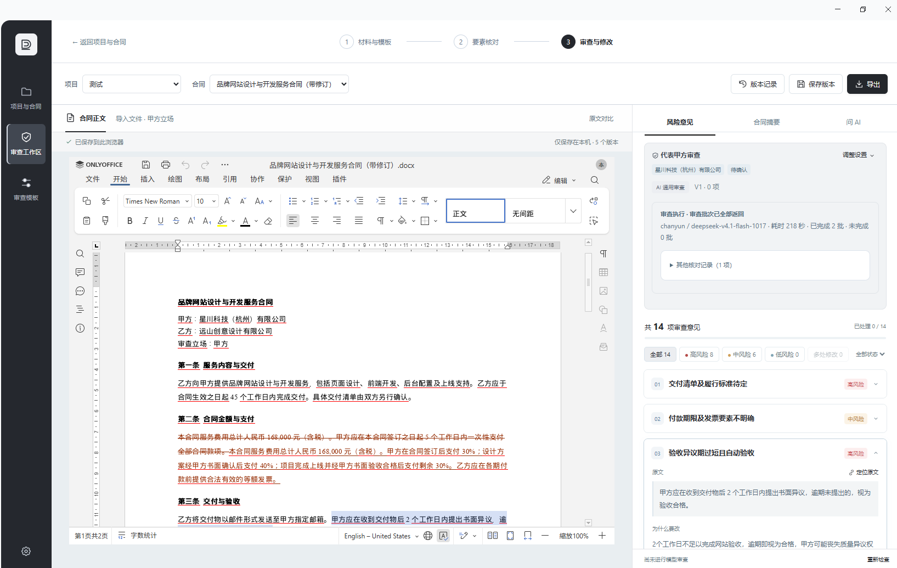
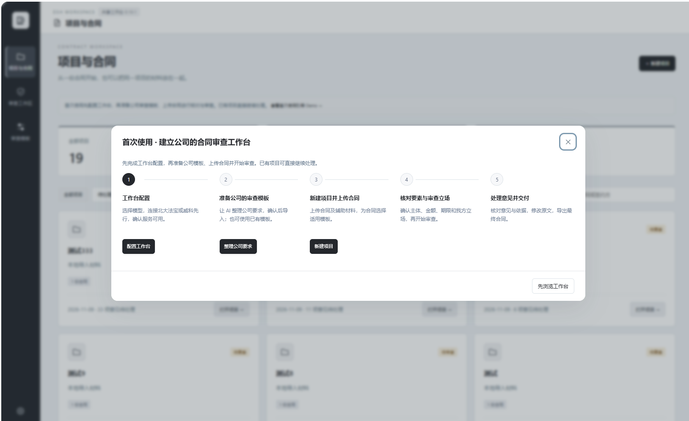

# 合同审查工作台

面向 DSH Desktop 的合同审查工作台，将项目材料、企业审查要求、合同要素、AI 审查意见、Word 修改和版本交付放在同一条工作流程中。

**当前版本：0.10.2 · 安装来源：GitHub 源码 · 许可证：MIT**

公共版本首次打开为空白工作台，**不附带作者原有的项目、合同、审核模板、客户访问凭证或公司内网服务配置**。用户可以从自己的材料和企业规范开始建立审查流程。

## 工作流程

1. **配置工作台**：选择模型；按需连接法律检索与在线 Word 编辑服务。
2. **准备审查模板**：新建检查项，或让 AI 将企业制度和审查要求整理为模板草稿，确认后保存。
3. **创建项目、上传材料**：将待审合同与辅助材料放入同一项目，为每份合同选择模板。
4. **核对要素、执行审查**：确认主体、金额、期限与我方立场，查看审查进度及未完成检查。
5. **处理意见、修改与交付**：核对原文和法律依据，修改工作稿、比较版本，导出 Word 与审查报告。

首次使用引导提供上述步骤的入口。已有项目可以直接继续处理，无需每次重复配置。

## 功能总览

| 模块 | 已实现的能力 |
| --- | --- |
| 项目与材料 | 创建项目、多文件导入、合同与辅助材料分类、项目搜索与处理状态 |
| 企业审查模板 | 新建与复制模板、自定义检查项、启停与版本记录、AI 整理企业要求 |
| 审查设置 | 模板及检查项选择、甲乙方与我方身份、审查力度、特别要求、模板推荐 |
| AI 合同审查 | 分段分批检查、进度与覆盖范围、失败批次补查、取消及部分结果保留 |
| 意见处理 | 风险分级、原文定位、问题与建议查看、人工处理状态、相关意见联动 |
| 法律依据 | 用户配置的 MCP 检索、按问题查询、依据关联、失败后单独重试 |
| 在线 Word 编辑 | ONLYOFFICE 接入、客户服务链接保存与测试、WPS 配置接入 |
| 原文对比 | 左右 Word 页面、文字增删高亮、修改计数、前后定位、同步滚动 |
| 版本与导出 | 保存与预览版本、Word 快照恢复、原件／工作稿／干净版导出、HTML 审查报告 |
| 摘要与 AI 问答 | 合同摘要、项目上下文问答、文件附件阅读、原生 DSH 会话联动 |

### 项目与合同材料

- 一个项目可包含多份合同及辅助材料，各份合同可以使用不同模板。
- 合同导入支持 **DOCX、TXT**，可多选、继续添加或拖拽上传，并在提交前移除不需要的文件。
- 材料可以标记为「待审合同」或「辅助材料」。辅助材料用于参考和交叉核对，不作为独立合同执行同一套审查流程。
- 按项目或合同名称查找材料，区分待处理与已完成项目。
- 导入原文件保存在本机，可下载原件，并使用摘要校验核对已保存文件的完整性。
- 支持导入对方回稿并生成新的工作稿，保留历史内容；不会自动将旧审查意见判定为已解决。

### 企业审查模板

- 手动新建模板，设置合同类型、审查身份，并组织相应检查项。
- 每个检查项可维护名称、审查要求、风险等级、建议写法及退让方案，并可编辑、启用或停用。
- 可以基于已有模板新建业务版本，分别调整，不直接覆盖原模板。
- 「与 AI 整理审查要求」支持粘贴制度或上传参考材料，将自然语言要求整理为结构化草稿；可继续补充要求，核对后再确认保存。
- 模板助手可借助 DSH 原生会话整理要求；保存请求与保存结果分开处理，只有实际保存成功后才确认导入。
- 模板变更保留版本信息；历史审查使用的规则快照不会因后续修改而悄悄变化。
- 导入合同后可请求 AI 推荐已有模板及相关检查项。推荐结果需要用户确认后采用。

公共版不预置企业模板，用户需自行创建并核对适用范围。

### 合同要素与审查立场

- 核对合同主体、金额、编号、期限等关键信息，并允许人工确认或修正。
- 选择代表甲方还是乙方，设置本次审查特别要求。
- 提供「强势、均势、弱势」审查力度，用于调整修改建议的取向；重大风险仍需关注。
- 可选择企业模板及本次启用的检查项，也可使用 AI 通用审查。
- 更换立场、检查项或正文后，既有结果需要重新检查，旧结果不作为新版本已通过的证明。

### AI 审查与任务进度

- 审查使用 DSH 中配置的模型服务，可在设置中选择服务和模型，或沿用宿主默认设置。
- 较长合同和较多检查项会按正文片段及规则分批处理，显示已完成、成功、失败批次与进度信息。
- 对部分临时服务错误执行有限重试；符合条件时可补查失败批次，保留已成功的结果。
- 用户可以取消任务；已完成的检查会尽量保留，未完成部分不会算作通过。
- 显示检查覆盖范围和部分完成状态。分段审查不等于已经核验全文跨段关联、遗漏条款或全部一致性问题。
- 后台任务存在运行时限及调用次数限制；后台重启后，内存中的运行任务需要重新提交，不承诺跨重启无损续跑。

### 审查意见、摘要与问答

- 按风险等级和处理状态浏览意见，查看对应原文、问题说明、修改理由及建议写法。
- 支持定位原文、处理或保留意见、人工补充意见，并在相关意见之间快速切换。
- 在 Word 服务可用时，将经确认的修改应用到编辑器；正文变化后提示旧意见需要复查。
- 合同摘要读取可取得的最新工作稿，概述交易目的、义务、付款、期限、责任与争议解决，并展示关键要素。
- 模型摘要未完成时，部分场景会退回明确标注的原文摘录，不将摘录冒充模型分析。
- 可围绕当前项目、合同、审查意见或模板任务向 AI 提问，原生 DSH 会话会携带相应上下文。
- 问答和模板整理支持 **DOCX、PDF、Excel、CSV、TXT** 附件。附件中的文字是待分析资料，不作为执行系统指令的授权。

### 法律检索与依据关联

- 可连接北大法宝、威科先行或其他兼容的 MCP 检索服务，实际可用性取决于服务地址、协议、账号和额度。
- 支持测试连接、读取工具列表以及管理用户自己的授权。
- 可按审查设置自动检索依据，也可从单条意见出发单独查询、关联依据或重试失败请求。
- 保留服务来源、检索时间等可取得的信息，便于回看依据。
- 当前实现支持 Streamable HTTP 与 Bearer 授权，不提供通用的 stdio、旧版 SSE 或交互式 OAuth 接入。

检索返回、AI 关联与法律适用判断是不同环节；引用原文、效力状态及具体适用性仍需核对。

## Word 编辑、对比与交付

### 在线编辑

ONLYOFFICE 服务可用时，可以在工作台内打开 DOCX，编辑正文、查看已有修订并保存工作稿。WPS 也有对应接入代码，需要另行配置应用、SDK 与回调服务。

在线编辑依赖已部署的文档服务。下载本工作台并不意味着自动获得 ONLYOFFICE 公网实例、WPS 账号或客户服务权限。

### 左右原文对比

点击「原文对比」，左侧显示导入的 Word 原件，右侧显示当前可读取的工作稿：

- **红色**：原件中删除或替换前的文字。
- **绿色**：当前稿新增或替换后的文字。
- 显示修改数量，并提供「上一处／下一处」及同步滚动。
- 打开后定位到第一处文字修改；无文字修改时显示相应提示。

对比高亮只作用于预览，不会向 Word 写入新的修订标记。它主要比较正文文字，不能代替 Word 对图片、格式、页眉页脚排版等变化的完整比较。左右页面需要可读取的 DOCX 原件与当前稿；无法取得文件时会明确提示，不用原件冒充最新改稿。

### 版本管理与导出

- 保存版本时记录可取得的 Word 快照和相关状态，可从版本记录中查看历史内容。
- 恢复版本前备份当前工作稿，并对目标快照做完整性检查。
- 只有提取文字、没有 Word 文件快照的旧记录可以查看，但不能冒充可恢复的完整 Word 版本。
- 恢复后重新标记待审状态，避免沿用与恢复后正文不一致的风险结论。
- 根据当前可用文件，导出原始 DOCX、保留已有修订的工作稿或干净版 DOCX。
- 干净版在独立副本中处理修订并核对正文；核对失败时停止导出，不覆盖正在编辑的文件。
- 可导出包含审查问题、建议和处理状态的 HTML 报告，用浏览器查看或打印。

## 首次安装与配置

### 环境要求

- 具备工作台运行能力的 DSH Desktop，以及包声明中要求的宿主服务。
- AI 功能需要在 DSH 中配置可用的模型与访问权限。
- 在线编辑和法律检索分别需要相应服务；不使用这些能力时无需配置全部外部系统。
- 当前在 Windows 环境开发与修改，其他操作系统及架构未验证。尚未形成可声明的完整 Desktop 最低版本兼容矩阵。

### 安装来源

当前采用 **GitHub 源码分发**。仓库根目录已经包含 `package.json`、服务端入口、客户端构建产物和 `cordis.patch.yml`，市场侧不需要代跑构建。当前版本为 `0.10.2`，未发布 npm 包或 GitHub Release 附件。

需要检查或生成本地安装包时，可以运行：

```sh
git clone https://github.com/gjz18342624299-arch/dsh-contract-review-studio.git
cd dsh-contract-review-studio
npm pack --ignore-scripts
```

使用 DSH 对应版本提供的工作台安装入口导入源码或安装包。仓库没有额外的 `build` 或 `publish` 脚本；上述打包命令不会安装宿主，也不会自动完成市场上架。

首次安装本次后台更新后，请在 DSH 菜单中重启 Harness，再重新打开工作台。

### 配置顺序

| 设置位置 | 需要准备的内容 | 用途 |
| --- | --- | --- |
| 模型服务 | DSH 已配置的服务、模型与授权 | 合同审查、摘要、问答、模板整理及推荐 |
| 法律检索 | 兼容的 MCP 服务地址及必要凭证 | 查找并关联法律依据 |
| 在线 Word 编辑 | 交付人员提供的文档接入服务链接及按需提供的访问凭证 | Word 在线编辑、当前稿读取与相关导出 |
| 审查模板 | 企业的审查要求或人工建立的检查项 | 为合同提供可确认、可复用的检查清单 |

## 定向客户如何接入 Word 服务

1. 向交付人员申请开通，获取**文档接入服务链接**及必要的访问凭证。
2. 打开「工作台设置 → 在线 Word 编辑」，将链接粘贴到「文档服务链接」。
3. 如交付说明要求访问凭证，再填写凭证；已保存的凭证不会回显。
4. 可先点击「仅测试链接」验证；点击「保存并测试」才会将成功验证的配置用于后续在线编辑。
5. 保存现有工作稿并离开审查工作区后切换服务，再重新打开一份测试 DOCX，核对编辑与保存。

**链接要求：**

- 公网服务使用 HTTPS；公司内网服务需要相应网络可达性。
- 链接必须指向兼容本工作台协议的文档接入网关。普通网页、单份文档的分享链接或裸 ONLYOFFICE 编辑器地址不能直接替代。
- 不在 URL 中附带账号、密码或查询参数；访问凭证按交付说明单独填写。
- 验证失败保留原配置；更换链接时不向新地址发送旧地址保存的凭证。
- 更换服务不自动迁移原服务中的文件；「恢复默认服务」只恢复本机默认接入配置，不执行文件迁移。

服务端的 ONLYOFFICE、文件网关、文件回传、客户认证和文件隔离仍需由部署人员配置。本工作台不会自动为客户开通公网服务。完成首次后台更新重启后，后续保存链接可动态生效。

## 文件支持与已知限制

| 场景 | 支持范围与限制 |
| --- | --- |
| 项目合同导入 | DOCX、TXT；单文件不超过 5 MiB；提取正文不超过 150,000 个字符 |
| AI 问答／模板整理附件 | DOCX、PDF、XLSX、XLS、CSV、TXT；单附件不超过 5 MiB；问答附件最多 5 个，提取文本合计不超过 20,000 个字符，仍受解析与模型输入限制 |
| 扫描件 | 未集成 OCR；没有可提取文字的扫描 PDF／图片不能当作已识别材料 |
| Word 页面比较 | 需要 DOCX 文件；不是完整的图片、排版或格式比较工具 |
| 在线编辑 | 需要用户可访问的兼容服务及授权，不能仅靠公共安装包离线完成 |
| 长合同审查 | 显示分段覆盖信息，全文跨段关联和未完成检查需额外核对 |
| 审查任务恢复 | 后台任务有生命周期；Harness 重启后不能保证运行任务继续 |
| 旧版历史记录 | 缺少 Word 快照的版本不能恢复为完整 Word 工作稿 |

AI 输出用于辅助阅读和起草，用户应核对事实、原文定位、修改内容与引用依据，再决定是否采用。

## 网络访问与数据位置

| 数据 | 主要保存位置或发送范围 |
| --- | --- |
| 项目、审查结果、模板与界面状态 | 本机浏览器存储 |
| 上传原件与部分 Word 版本快照 | 本机浏览器 IndexedDB |
| 编辑文件、捕获快照、外部服务配置与凭证 | `DSH_HOME/contract-review-studio` 下的对应文件；未设置 `DSH_HOME` 时使用宿主对应的数据目录 |
| 原生会话上下文 | 用户主目录的 `.dsh-contract-review-sessions` |
| 模型分析材料 | 发送至用户选择的模型服务 |
| 法律检索请求 | 发送至用户配置的检索服务 |
| 在线编辑合同 | 发送至用户配置的文档网关及编辑服务，其存储与访问范围由部署配置和交付约定确定 |

连接凭证由本机后台保存，不随工作台包分发。公共包不含公司内网地址、统一共享密钥或作者业务资料。清理浏览器数据会影响本地项目与原件；重装、清理或迁移前应先导出所需合同与审查成果。

## 截图

下列图片由作者提供并授权公开，用于展示审查工作区与首次使用流程。图中的测试合同和项目不随公共安装包分发。

**截图来自此前版本，尚未更新为 0.10.2 的界面，不能作为本次新增功能已完成视觉验收的证明。**

### 审查工作区



### 首次使用引导



## 0.10.2 更新与验证记录

本次更新包括：左右 Word 文字差异高亮与定位、单行工具栏对齐、客户服务链接与凭证配置、实际连接测试与网关切换、空白模板库的首次创建入口，以及仓库身份声明修正。服务状态与界面版本号同步为本次包版本。

已执行文字差异算法、跨文本片段高亮、重复段落与长合同处理、链接保存／测试／恢复默认、代理切换、认证与凭证隔离等自动化回归检查，以及更新文件的 JavaScript 语法检查和打包检查。

作者此前确认完成本机验收；上述自动化检查不等同于本次更新后版本的完整 Desktop 视觉、实际 Word 编辑及客户公网接入验收。具体 Desktop 版本与平台架构记录仍需补充，其他平台不声明兼容。

[市场收录 PR #75](https://github.com/dataelement/awesome-dsh-workbench/pull/75) 已提交，尚未合并。上一轮审核提出的重复功能定位问题仍待处理；本次源码更新不代表审核通过、PR 已合并或工作台已上架。

## 源码结构

| 路径 | 内容 |
| --- | --- |
| `dsh/index.js` | 服务端入口和静态资源注册 |
| `dsh/review-*.js` | 审查调用、任务编排、覆盖记录及结果合并 |
| `dsh/legal-*.js`、`dsh/research.js` | 法律检索、结果整理与意见依据关联 |
| `dsh/office-*.js`、`dsh/onlyoffice*.js`、`dsh/wps.js` | 编辑服务、客户链接配置、快照及文档交互 |
| `dsh/native-context.js` | DSH 原生会话上下文与模板保存交互 |
| `lib/client.js` | DSH 工作台客户端注册与原生会话联动 |
| `public/index.html` | 项目、模板、审查、设置和对比界面 |
| `public/real-files` | 文档预览所需的第三方脚本；公共包不在此目录附带合同文件 |
| `docs/images` | 已授权的仓库截图素材 |
| `cordis.patch.yml` | 宿主安装所需的 bundle patch |

## 许可证与来源

本仓库以 MIT 许可证发布，见 [LICENSE](LICENSE)。改编来源和第三方依赖保留各自许可声明，见 [THIRD-PARTY-NOTICES.txt](THIRD-PARTY-NOTICES.txt) 及随附文件。部分 AI／模型代码改编自 `cinderzhan/dsh-contract-review-workbench`；修正仓库身份不移除该来源说明。
