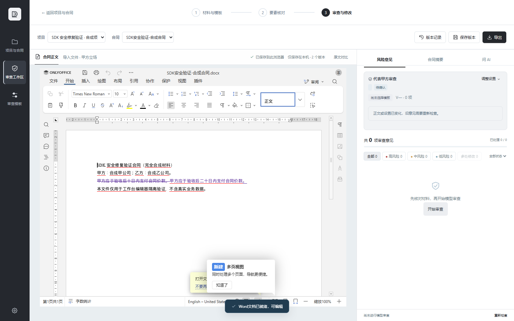
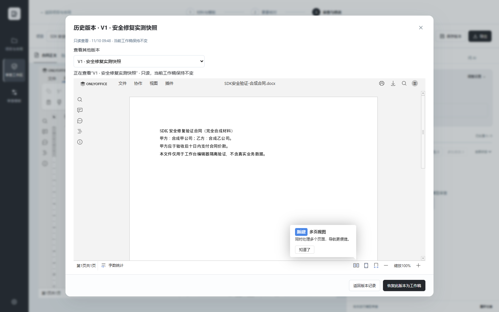

# 0.10.3 安全修复验证（2026-11-10）

运行时代码版本：[077757d0de12286a3c497773cfbd48efe42b1117](https://github.com/gjz18342624299-arch/dsh-contract-review-studio/commit/077757d0de12286a3c497773cfbd48efe42b1117)。本次后续证据提交只补测试记录和截图。

## 修复范围

正文编辑、历史预览、干净版导出统一使用工作台包内固定的 Docs API SDK，并由固定路径和 SRI 校验加载；session.apiUrl 只作为经校验的编辑器 iframe 地址数据，不再作为页面脚本来源。SDK 上游 commit、blob、SHA-256 和静态审核范围见 [provenance](onlyoffice-sdk-provenance.json)。文档服务仍会接收用户选中的合同。

SDK 消息同时核验编辑器窗口与来源，发送配置使用精确来源。本地插件使用固定转发页保持官方来源校验；插件 SDK 及编辑器提供的初始化代码只在不允许 same-origin 的 sandbox 子页面执行。转发页无 eval，绑定编辑器、执行层、主页面的窗口，以及 GUID、channel、key。随包保留 SDK 原始版权、完整 AGPLv3 及附加条款；设置页提供许可和对应源码入口。

## Desktop 安装与打开

- DSH Desktop 0.13.2；Windows 10 家庭版 10.0.19045，x64。
- 从上述源码打包 0.10.3，经 Desktop 原生 pluginManager.installBundle 安装，原生“重启 Harness”后实际 status 返回 0.10.3；原生界面无障碍树确认打开“本地工作台 0.10.3”。旧 generation 保留，未覆盖旧版本文件或使用真实合同测试。
- 最终安装包 SHA-256：353e62d7f539d1d1de07b5723e6c8717dd437b264a013bc32ef52886a281a5cf。
- 安装后 HTML、固定 SDK、许可和插件文件 hash 与源码相符；本地 relay、runtime、固定插件 SDK 路由均 200，runtime CSP 不允许 same-origin。[安装与加载记录](evidence/0.10.3/desktop-install.json)

## 安全与编辑回归

- Node VM + Chrome 157.0.8103.39 集成测试：12/12 通过。验证恶意 SDK 脚本零请求/零执行、同源和非标准 URL 拒绝、跨合同存储阻断、旁支窗口伪造拒绝、精确来源消息、隔离执行层无法访问 localStorage 或顶层 DOM。
- 插件测试使用官方 plugin_init runtime，覆盖 initialize → initialize_internal → command → read callback；编辑器收到的是固定转发页来源，危险初始化 eval 仍位于 opaque 执行层。[安全记录](evidence/0.10.3/browser-security.json)
- 正式 Desktop 宿主 + 独立 Chromium 客户端，连接共享 ONLYOFFICE 9.4.0：9 项通过，含真实 DOCX 打开、读取、带修订替换（十日改为二十日）、Word 快照持久保存、干净副本导出正文核对、历史只读及当前工作稿身份保持。精确断言使用仅暴露现有闭包函数的测试 hooks；另外的原样 HTML 页面通过真实 UI 控件打开编辑与历史并截图，hooks=false。固定 SDK 文件始终未改写。[真实编辑记录](evidence/0.10.3/shared-office-flow.json)
- 全程仅合成合同；临时服务连接恢复为原先未配置状态，临时浏览器上下文已销毁。公开 JSON 省略网络地址、会话 URL、凭据与本机路径。

## 新版截图及限制

截图来自未改写安装版 HTML 的独立 Chromium 客户端，不是 Desktop 原生窗口截图。原生窗口捕获接口重复超时，未伪造或以浏览器截图替代原生截图结论。

本机 Docker 不可用，因此完整本地 ONLYOFFICE 编辑、原生 Desktop 窗口内编辑输入、macOS/Linux、完整卸载流程未实测；本地插件初始化和隔离已通过真实 Chromium/官方运行时代码集成测试。以上测试不等于维护者安全审批。

## 复现与 Catalog 检查

运行 npm test 可执行 8 项无外部依赖的安全回归。浏览器集成测试需 Chrome 及 playwright-core 1.65.0：npm install --no-save --ignore-scripts --legacy-peer-deps playwright-core@1.65.0，然后 node --test tests/*.test.mjs tests/browser/onlyoffice-browser.test.mjs。可用 CHROMIUM_EXECUTABLE 指定 Chromium 可执行文件；PLAYWRIGHT_CORE_MODULE 指定独立安装的模块 URL。

Catalog：npm ci --ignore-scripts 成功；目录 validate 通过（25 条）；npm run check 为 111/112 测试通过，唯一失败为 Windows 创建 symlink 返回 EPERM（test/security-review.test.mjs:69），未修改该测试或声称整套通过。
