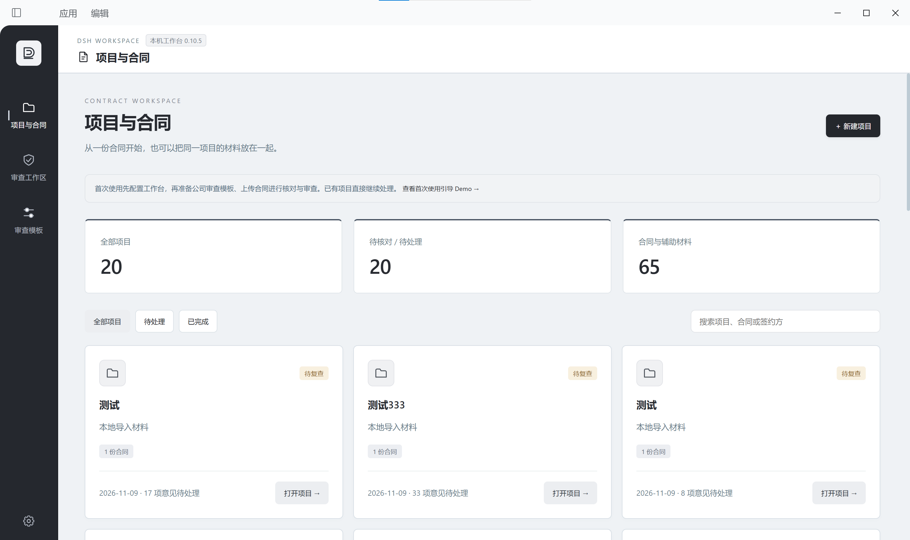
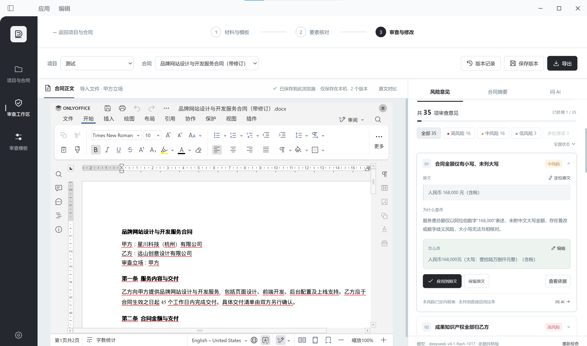

# 0.10.5 验证记录（2026-11-11 更新）

## 后续交互与项目管理更新

要素核对支持逐项确认、标记更正、再次点击取消，以及全部确认和取消全部确认。修改核对值后须重新确认；风险页区分未开始、正在审查、完成、停止及失败状态。审查区支持拖动分栏、折叠整栏和独立收起风险卡片，三个标签等宽，折叠图标居中；这些操作保留当前 Word 编辑器。

所有项目卡片与材料页统一提供「删除项目」。确认后完整项目、合同、审查记录和版本进入本地回收记录，原件和远程 Word 文件保留；其他项目仍引用的合同继续保留并修正归属。删除最后一个项目后的空工作台会持久化，不自动恢复演示。

当前全部单元及浏览器测试共 54 项通过。独立 Chromium 验证了删除、取消、共享资料保留、空工作台刷新、要素确认撤销、运行状态和分栏操作；这些浏览器验证不冒充原生 Desktop 窗口实测。实际 ONLYOFFICE 9.4 全合成多页合同定位测试也通过：第六页原文选区位于 794px 编辑区的 397px 中点，重复定位保持居中且正文未改变。

复现自动检查：安装 `playwright-core`，设置可用的 Chromium 路径后执行 `node --test tests/*.test.mjs tests/browser/*.test.mjs`。浏览器脚本默认采用 Windows 本机 Chrome，其他环境需按本机路径调整；真实 Word 服务联调与本地模拟测试分别记录，不将模拟编辑器结果当作实际 Word 持久化证明。

## 首次使用演示项目

后续新增一个普通的虚构演示项目，随安装首次加入项目列表；已有材料的工作台也只补充一次，保持原有项目、当前合同和编辑状态。演示没有首页固定入口，可确认删除并保留本地回收记录、原件及防止自动恢复的标记。同名和 ID 冲突时不覆盖用户资料。

演示自带真实 DOCX，六条风险明确标注为预设。已在独立 Chromium 上通过当前源码连接本机 Desktop 后台和既有 ONLYOFFICE 服务，完成真实 Word 打开、界面定位、采纳付款建议、保存 Word 版本及界面导出。下载文件的可见正文与新付款条款一致，OOXML 保留实际增删修订；该结果为独立浏览器验证，不冒充原生 Desktop 窗口实测。详见[说明](onboarding-demo.md)。

## 原生 Desktop 验收

用户于 2026-11-11 确认：已使用另一台电脑完成公开 0.10.5 的验收，Word 保存测试成功。该结果记录为**用户实测完成**，并非本次代理独立操作或复现的结果；未额外声称已验证未明确报告的功能。

另一台电脑的 Desktop 版本、操作系统和架构未单独提供。此前已只读核对的本机环境为 DSH Desktop 0.13.2（文件版本 0.13.2.0）、Windows 10 家庭版 10.0.19045、x64；不能将此环境自动归属于另一台电脑。

## 用户提供的原生窗口截图

用户提供并明确授权公开以下两张原始截图：项目与合同页面可见 0.10.5 标签；审查工作区可见 ONLYOFFICE 编辑器及文档。保存成功由用户实际测试确认，静态截图本身不证明保存后的持久化。截图为此前本机原生窗口实拍，不将其标为另一台电脑重新安装过程的截图，也不以它证明精确 Git 提交的安装来源。

截图内可见的合同、公司名称和材料已获用户公开授权，仅用于展示；不作为公共安装包预置数据。原 0.10.3 独立 Chromium 截图保留为历史证据，来源见 [历史记录](verification-0.10.3.md)。

## 本次注册修复与检查

### 侧栏悬停提示一致性

后续 UI 调整将导航项的 hover 和选中提示统一为原配色的 2 × 16px 小竖线；悬停和按下均不再显示整块背景，选中项的标记继续保留。只修改独立侧栏样式，不改导航事件、注册、编辑器或存储代码。此样式调整晚于下述用户验收，未将既有截图标为新 hover 状态实拍。

最新审核指出客户端注册缺少 repository。现已在 lib/client.js 的 desktopWorkbenches.register 对象添加规范的 GitHub 仓库 URL：https://github.com/gjz18342624299-arch/dsh-contract-review-studio；不声明注册 id，包名、版本 0.10.5 和业务入口保持一致。

注册修复时 npm test 的 8 项安全回归通过，客户端语法检查通过。固定 ONLYOFFICE SDK、编辑器隔离与消息校验未改动。后续首次使用演示增加了明确标记的合成合同与预设风险，不预置作者真实材料、企业模板或服务配置。具体源码与验证范围以对应提交为准。

本次注册字段修复发生在用户报告验收之后；没有将此前的用户实测描述为对修复后精确提交的重新验收。最终兼容性和审核结论由维护者复审确认。原生会话创建／恢复、完整卸载后的保留行为、macOS 和 Linux 未新增验证。
